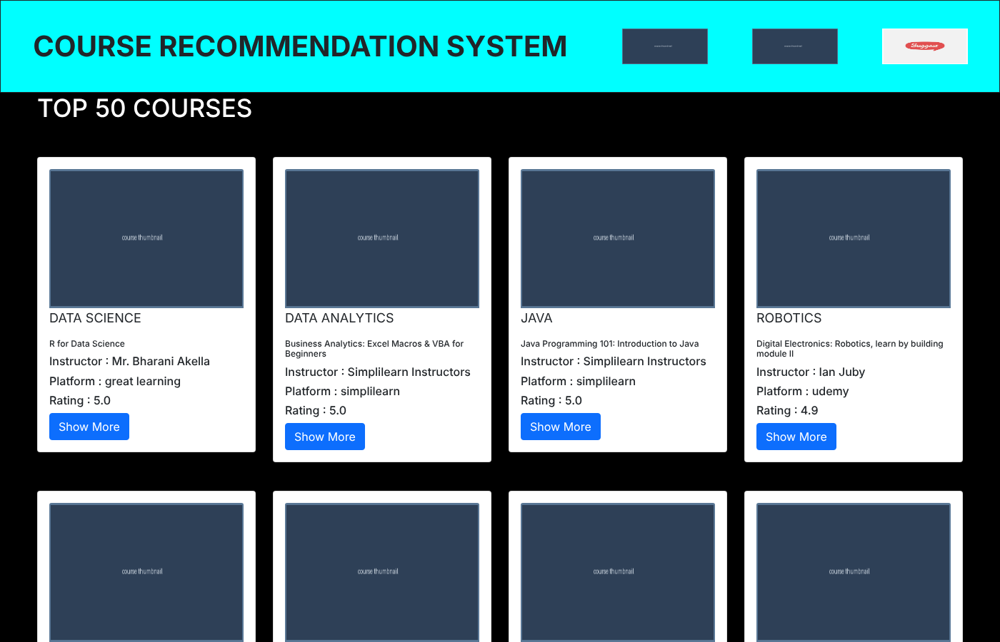
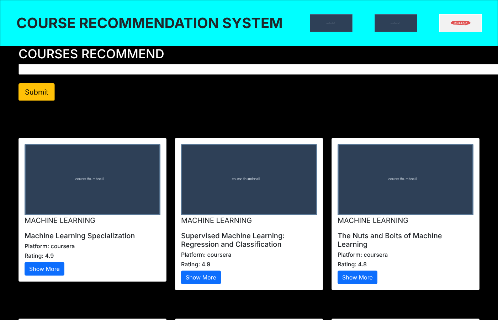
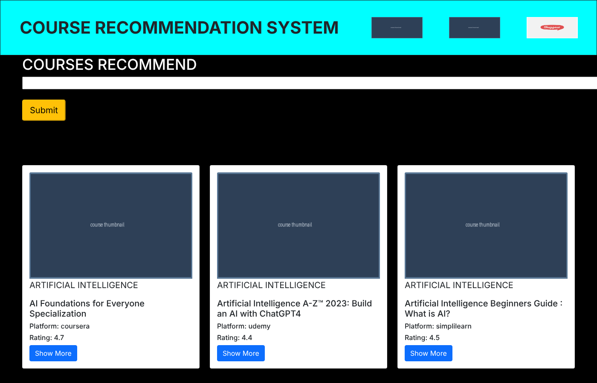
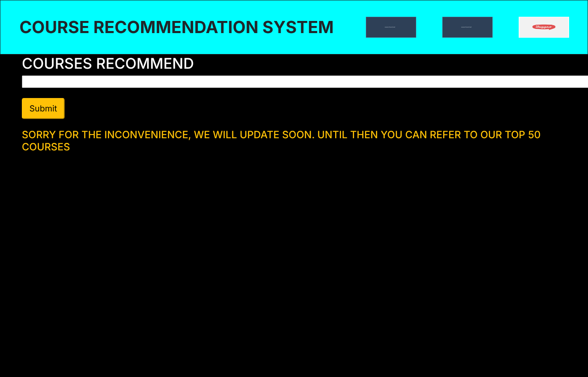
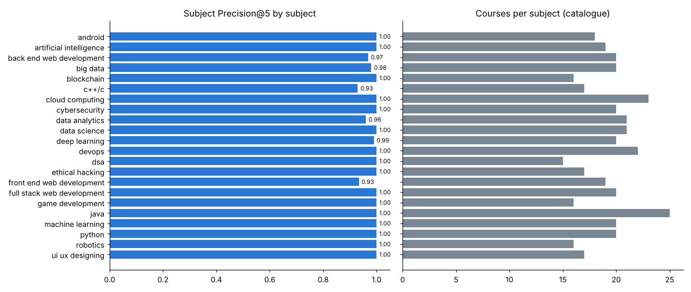

# 🎓 Course Recommendation System

A content-based **course recommender** built with **Flask, Pandas and scikit-learn**. It indexes 400+ online courses from Udemy, Coursera, Simplilearn and Great Learning across 22 tech subjects and helps learners:

- browse the **Top 50 highest-rated courses**,
- get the **top 10 courses for any subject** (e.g. *Machine Learning*, *DevOps*, *UI UX Designing*), and
- find **5 similar courses** to one they already like, using cosine similarity.


---

## 📸 Screenshots

| Home: Top 50 courses | Recommend by subject |
|---|---|
|  |  |

| Similar courses (cosine similarity) | Unknown subject handled gracefully |
|---|---|
|  |  |

> The course thumbnails load from external image URLs in the dataset. These screenshots were taken offline, so the thumbnails show as placeholders.

---

## 🧠 How it works

```
dataset.csv ──► Pandas cleaning ──► pivot table (course × subject, values = rating)
                                         │
                                         ▼
                           cosine_similarity(pt)  ──►  similarity_score.pkl
                                         │
             Flask app (app.py) ◄────────┘   + populardf.pkl (Top 50 by rating)
```

1. **Popularity model.** Courses are sorted by rating and the top 50 are shown on the home page.
2. **Subject filter.** Returns the first 10 courses for the subject the user types, case-insensitive.
3. **Content-based similarity.** A `course × subject` pivot table (values are ratings) is turned into vectors. **Cosine similarity** between those vectors ranks the 5 closest courses.

The notebook `course_recom.ipynb` contains the full exploration and model-building steps.

## 🗂️ Project structure

```
├── app.py                  # Flask web app (3 pages, 2 recommendation endpoints)
├── course_recom.ipynb      # EDA + model building notebook
├── dataset.csv             # 430 courses: platform, name, instructor, subject, rating, link …
├── *.pkl                   # Pre-computed model artefacts (pivot table, similarity matrix, Top-50)
├── templates/              # Bootstrap HTML pages
├── tests/test_app.py       # 10 automated test cases (pytest)
├── evaluate.py             # Offline evaluation script
└── docs/                   # Screenshots, evaluation chart, test report
```

## 🚀 Getting started

```bash
git clone https://github.com/ChetanyaB/Course-Recommendation-System.git
cd Course-Recommendation-System
pip install -r requirements.txt
python app.py            # open http://127.0.0.1:5000
```

| Page | URL | What to type |
|---|---|---|
| Top 50 courses | `/` | — |
| Recommend by subject | `/recommend` | a subject, e.g. `python`, `devops`, `ui ux designing` |
| Similar courses | `/recommended` | an exact course name, e.g. `AI For Everyone` |

---

## ✅ Test case scenarios

Run them with `pip install pytest && pytest -v`.

| # | Scenario | Input | Expected result | Status |
|---|---|---|---|---|
| TC01 | Home page loads | `GET /` | 200 OK, 50 courses rendered | ✅ Pass |
| TC02 | Subject search | `Python` | The 10 Python courses are listed | ✅ Pass |
| TC03 | Case-insensitive subject | `MACHINE LEARNING` vs `machine learning` | Identical results | ✅ Pass |
| TC04 | Subject stored with trailing space | `ui ux designing` | Results shown, no crash | ✅ Pass |
| TC05 | Unknown subject | `cooking` | Friendly "Sorry… refer to Top 50" message | ✅ Pass |
| TC06 | Empty input | `"   "` | Friendly message, no crash | ✅ Pass |
| TC07 | Similar-course lookup | `AI For Everyone` | 5 related AI courses | ✅ Pass |
| TC08 | Query course excluded from its own results | `AI For Everyone` | Exactly 5 results, none of them the query | ✅ Pass |
| TC09 | Unknown course name | `xyz` | "Course not found" message | ✅ Pass |
| TC10 | Case-insensitive course lookup | `ai for everyone` | Results shown | ✅ Pass |

Full output: [`docs/test_results.txt`](docs/test_results.txt).

### 🐞 Bugs found and fixed during testing

| Issue | Before | After |
|---|---|---|
| Unknown subject (e.g. `cooking`) | `UnboundLocalError` → **500 Internal Server Error** | Friendly message |
| Subject with stray whitespace in data (`ui ux designing `) | **500 error** | Matching now trims whitespace |
| Unknown course name on the "similar courses" page | `IndexError` → **500 error** | "Course not found" message |
| Course lookup was case-sensitive | `ai for everyone` failed | Case-insensitive match |
| Similar-course cards showed the rating where the subject should be | Header read `4.7` | Header shows the subject |

---

## 📊 Evaluation

The catalogue has no user–item interaction data, so the recommender is evaluated offline on the **395 unique courses**. Each course is used as a query and the top-5 recommendations are scored (`python evaluate.py`).

| Metric | Value | What it means |
|---|---|---|
| **Subject Precision@5** | **0.989** | 98.9% of recommended courses share the query course's subject |
| Mean cosine similarity @5 | 0.990 | Recommendations sit very close to the query in vector space |
| Catalogue coverage | 33.4% | Share of the catalogue that appears in at least one top-5 list |
| Mean rating of recommendations | 4.53 / 5 | In line with the catalogue average (4.56) |
| Mean latency per query | 0.04 ms | Pre-computed similarity matrix makes lookups instant |
| Subject search coverage | 22 / 22 | Every subject returns a full list of 10 courses |



**Observations**

- Precision is high because the feature vector is the course's subject profile. Courses tagged with more than one subject (C++/C, front-end and back-end web development) explain the small drop below 1.0.
- Coverage of 33% shows a **popularity/position bias**: ties in similarity resolve to the same few courses.

**Possible next steps:** add TF-IDF or sentence embeddings over course descriptions, break ties by rating, and collect user ratings for collaborative filtering.

---

## 🛠️ Tech stack

`Python` · `Flask` · `Pandas` · `NumPy` · `scikit-learn` · `Bootstrap 5` · `Jinja2` · `pytest`

## 👤 Author

**Chetanya Bhadravati** · M.Tech AI & ML, Symbiosis Institute of Technology
[LinkedIn](https://www.linkedin.com/in/chetanya-bhadravati-8a3703292) · [GitHub](https://github.com/ChetanyaB)
